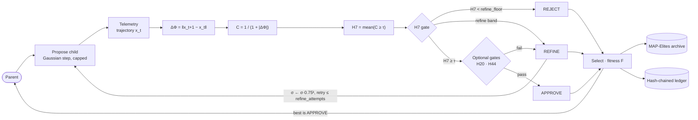
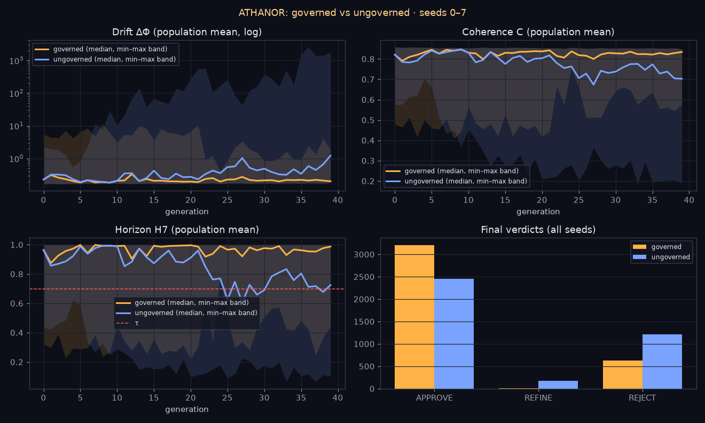

<p align="center">
  
</p>

<p align="center">
  <a href="https://github.com/jacksonjp0311-gif/Athanor/actions/workflows/ci.yml"></a>
  
  <a href="https://github.com/jacksonjp0311-gif/Athanor/releases/latest"></a>
  <a href="LICENSE"></a>
</p>

<p align="center">
  <b>Measure drift. Gate change. Ledger every verdict.</b>
</p>

---

**ATHANOR** is a deterministic coherence governor for recursive, self-modifying systems. Before a candidate change is committed, ATHANOR measures its internal drift **ΔΦ** along a telemetry trajectory, converts it to coherence **C**, computes the stability horizon **H7**, and issues a hard verdict: **APPROVE**, **REFINE**, or **REJECT**. Every verdict, along with the gate checks behind it, is written to a hash-chained ledger. The same seed and config reproduce the same ledger and the same run digest, and `athanor replay` checks that.

## Why it matters

A system that rewrites itself needs a referee that is *outside* the thing being optimized. ATHANOR keeps that referee small and explicit:

- **Coherence comes first.** A change has to meet the H7 stability gate before fitness can promote it to parent.
- **Every verdict is explained.** Each ledger row lists the gates that were evaluated, their values and limits, the REFINE attempts, and the parent the candidate came from.
- **Every run can be audited.** Edited, deleted, inserted, or reordered ledger rows are detected, and a run can be replayed and compared bit-for-bit through its digest.

## Contents
[Governance loop](#governance-loop) · [Quickstart](#quickstart) · [Benchmark](#benchmark-governed-vs-ungoverned) · [CLI](#cli-reference) · [Configuration](#configuration-reference) · [Guarantees](#guarantees) · [Run artifacts](#run-artifacts) · [Architecture](#architecture) · [Testing](#testing) · [Theory](#theory--manuscripts) · [Roadmap](#roadmap) · [Changelog](CHANGELOG.md)

## Governance loop



Optional gates can only **downgrade** APPROVE to REFINE. They never rescue a REJECT and never upgrade a verdict. A generation's best-fitness candidate becomes the new parent **only if** its verdict is APPROVE, and each such decision goes into `decision_record.json`.

## Quickstart

Install straight from GitHub (Python 3.10+):

```bash
pip install git+https://github.com/jacksonjp0311-gif/Athanor.git            # latest main
pip install git+https://github.com/jacksonjp0311-gif/Athanor.git@v2.3.0     # pinned release
```

Each [GitHub release](https://github.com/jacksonjp0311-gif/Athanor/releases) also has the built wheel and sdist attached (`pip install athanor-2.3.0-py3-none-any.whl`). ATHANOR is **not published on PyPI**. The name `athanor` on PyPI belongs to an unrelated project, so `pip install athanor` will **not** install this package.

For development:

```bash
git clone https://github.com/jacksonjp0311-gif/Athanor.git && cd Athanor
python -m pip install -e ".[dev]"
```

```bash
# 1. run a governed evolution loop
athanor run --config configs/toy_experiment.yaml --tag demo

# 2. verify the hash chain of the verdict ledger
athanor verify data/archives/demo

# 3. replay from the saved config and confirm the digest matches
athanor replay data/archives/demo
```

Each command prints one JSON object to stdout and exits non-zero on failure, so it fits in CI and scripts.

## Benchmark: governed vs ungoverned

`athanor bench` runs the **same self-modification task** twice per seed:

- **governed**: the normal loop, where verdicts gate REFINE retries and parent promotion.
- **ungoverned**: `governor.enabled: false`. ΔΦ, C, H7 and verdicts are still measured and ledgered, but the best-fitness child **always** becomes the parent and nothing is retried.

The task ([`configs/bench.yaml`](configs/bench.yaml)) is built so that only the governor resists drift. Selection is coherence-blind (`alpha: 1.0`, so fitness rewards small proposal steps only), and proposals are large (`proposer_sigma: 0.5`, `proposer_step_cap: 2.0`) over 40 generations × 12 candidates. Telemetry is ATHANOR's built-in synthetic linear dynamics, so these numbers describe this toy system, not any real AI model.

Reproduce exactly (the measured run took about 7 s):

```bash
athanor bench --config configs/bench.yaml --seeds 0-7 --out docs/benchmark --chart docs/assets/benchmark.png
```

<p align="center"></p>

Measured with v2.3.0, seeds 0–7. Population means per generation; "last 10" means generations 30–39.

| Metric | Governed | Ungoverned |
|---|---:|---:|
| Mean H7, last 10 gens | **0.866** | 0.637 |
| Mean C, last 10 gens | **0.789** | 0.629 |
| Median ΔΦ, last 10 gens | **0.232** | 0.524 |
| Mean ΔΦ, last 10 gens | **0.440** | 137.168 |
| Worst generation ΔΦ (any seed) | **11.661** | 2575.680 |
| APPROVE / REFINE / REJECT | 3209 / 2 / 629 | 2456 / 173 / 1211 |
| Parent promotions | 265 | 320 |
| Promotions of non-APPROVED parents | 0 | 115 |

**How to read it, including where the governor does *not* win:**

- On **3 of 8 seeds** (2, 3, 7) the two modes are identical, because the ungoverned run never promoted a non-APPROVED parent. The governor only matters once the task drifts.
- On the other 5 seeds the governed run ends with higher H7 and lower drift. The ungoverned mean ΔΦ is dominated by a few blow-ups (seed 6 reaches a last-10 mean ΔΦ ≈ 1015), so the median is the fairer typical-case comparison: 0.232 vs 0.524.
- The governor **does not guarantee** staying above τ. On seeds 0 and 5 the governed population's last-10 H7 is 0.625 and 0.506, below τ = 0.70. It blocks unstable *parents*, but children proposed from a stable parent can still be unstable.
- It has a cost: **55 fewer parent promotions** (265 vs 320), meaning less exploration, which is the price of refusing non-APPROVED changes.

Full per-seed results are in [`docs/benchmark/results.md`](docs/benchmark/results.md) and [`results.json`](docs/benchmark/results.json), including every run digest.

## CLI reference

| Command | What it does | Exit code |
|---|---|---|
| `athanor run --config CFG [--out-dir DIR] [--tag NAME]` | Runs the loop and writes a run folder (`run_<UTC timestamp>` or `NAME`). A tagged folder that already has a ledger is never overwritten. | `0` |
| `athanor verify RUN` | Checks `seq`, `prev_hash`, and `row_hash` for every ledger row and reports `first_bad_seq`. | `0` ok · `1` broken |
| `athanor replay RUN [--out-dir DIR]` | Re-runs from `RUN/config.json` and compares the digest with the original ledger head. | `0` match · `1` mismatch · `2` no config |
| `athanor diff RUN_A RUN_B` | Compares two runs: digests, first divergent ledger row, changed config keys, verdict counts, promotions, and stats deltas. | `0` identical · `1` different |
| `athanor bench [--config CFG] [--seeds 0-7] [--out DIR] [--chart PNG]` | Governed vs ungoverned comparison across seeds. Writes `results.json`, `results.md` and a chart. Without `--config` it uses a built-in copy of `configs/bench.yaml`. | `0` |
| `athanor --version` | Prints the version. | `0` |

`athanor --config CFG` (the 2.0 form) still works and is the same as `athanor run`. You can also use `python -m athanor ...`.

## Configuration reference

Configs are YAML files. `inherits: base.yaml` **deep-merges** nested sections, and inheritance cycles are rejected. Every field is validated at load time.

| Key | Default | Meaning |
|---|---|---|
| `seed` | `1337` | Root seed. Every random stream is derived from it. |
| `threshold_h7` (τ) | `0.70` | APPROVE needs `H7 ≥ τ`. Also the per-step coherence threshold. |
| `refine_floor` | `0.50` | REFINE band is `[refine_floor, τ)`. Must be `≤ τ`. |
| `refine_attempts` | `2` | Max REFINE retries. Each retry scales σ by `0.75ᵏ`. |
| `alpha` | `0.70` | Fitness `F = α·q + (1−α)·H7`, where `q = 1/(1+‖δ‖)`. |
| `dphi_mode` | `l2` | `l2` (step distance) or `cosine` (step angle). |
| `steps_per_candidate` | `24` | Telemetry trajectory length. |
| `population` / `generations` | `16` / `24` | Loop size. |
| `genome_dim` | `64` | Genome dimension. |
| `telemetry_noise` | `0.02` | Process noise in the telemetry dynamics. |
| `proposer_sigma` / `proposer_step_cap` | `0.12` / `0.50` | Gaussian proposal scale and max step norm. |
| `governor.enabled` | `true` | `false` gives the ungoverned baseline: verdicts are recorded but never block promotion, and REFINE retries are off. |
| `gates.h20.enabled` | `false` | **H20 noise immunity.** Perturbs ΔΦ by `U(−σ, σ)` and requires `I20 ≥ min_immunity`. |
| `gates.h20.sigma` / `min_immunity` | `0.05` / `0.90` | H20 parameters. |
| `gates.h44.enabled` | `false` | **H44 boundary excess.** Requires `H7 − τ ≥ min_excess`, a margin over the gate. |
| `gates.h44.min_excess` | `0.0` | H44 margin. |
| `archive.bins` | `[16, 16]` | MAP-Elites grid over (H7, ‖δ‖). |
| `run.out_dir` / `run.tag` | `data/archives` / *unset* | Output location and an optional fixed folder name. |

With both gates disabled (the default), verdicts depend only on the H7 gate.

## Guarantees

These are the properties ATHANOR is built and tested to provide. Each one has a precise scope:

- **Determinism.** For a fixed resolved config, the ledger, decision record, archive, and run digest are identical across runs on the same software stack. Proposal, telemetry, and H20 perturbation streams are each derived from `SeedSequence(seed, …, gen, idx, attempt)`, so a candidate's result does not depend on how many REFINE retries other candidates used. Float results can differ across NumPy builds or platforms; `replay` and `diff` will report that.
- **Tamper evidence.** Each row stores `prev_hash` and `row_hash = SHA-256(canonical JSON without row_hash)`. Editing, deleting, inserting, or reordering rows makes `verify` fail at the first bad row. The chain makes tampering *detectable*. It does not stop someone from rewriting the whole file and re-hashing it. To guard against that, store the run digest from `metadata.yaml` somewhere else.
- **Replay.** `athanor replay` re-runs from the saved `config.json` and passes only if the original ledger verifies **and** the new digest matches it.
- **Monotone gating.** Optional gates can only make a verdict stricter (APPROVE → REFINE).

## Run artifacts

| File | Contents |
|---|---|
| `ledger.jsonl` | One hash-chained row per candidate: verdict, reason, H7 metrics, `checks[]`, `refine_trail[]`, `parent_id`. |
| `decision_record.json` | Gate settings, verdict counts, and per-generation lineage (`parent_before` → `parent_after`, `promoted`, reason). |
| `config.json` | Fully resolved config, used for replay. |
| `metadata.yaml` | Timestamp, seed, config hash, `run_digest`, `ledger_rows`, optional `ATHANOR_GIT_HASH`. |
| `archive.json` / `archive.pkl` | MAP-Elites archive (portable JSON, plus the legacy pickle). |
| `archive_stats.json` | Archive fill, mean H7/F, and verdict counts. |
| `h7_trace.png`, `fitness_trace.png`, `dashboard.html` | Plots and a static dashboard. |

## Architecture

```text
src/athanor/
├── core/          ΔΦ, C, H7 math (coherence.py), telemetry dynamics, types
├── agents/        Telemetry · Proposer · Verifier (H7/H20/H44 gates) · Selector · Archivist
├── adapters/      Pluggable proposal strategies (ProposerAdapter, GaussianNoiseAdapter)
├── evolution/     dgm_loop.run(): the governed loop; MAP-Elites archive
├── ledger/        Hash-chained LedgerWriter and verify_ledger
├── experiments/   Config loading, deep-merge inheritance, validation
├── bench.py       Governed-vs-ungoverned comparison (athanor bench)
├── scripts/       CLI: run · verify · replay · diff · bench
└── utils/         Seeding, JSONL logging, plots and dashboard
configs/           base.yaml, toy_experiment.yaml, bench.yaml
docs/benchmark/    Committed benchmark results (results.md, results.json)
docs/              Architecture notes, LaTeX manuscripts, assets
tests/             Unit and integration tests (pytest)
```

You can use it as a library too:

```python
from athanor.experiments.registry import load_config
from athanor.evolution.dgm_loop import run
from athanor.ledger import verify_ledger

out = run(load_config("configs/toy_experiment.yaml"))
assert verify_ledger(f"{out['run_path']}/ledger.jsonl").ok
print(out["run_digest"])
```

## Testing

```bash
pip install -e ".[dev]"
pytest -q
```

The suite covers the coherence math, config validation and inheritance, the ledger (edit, delete, and reorder detection), determinism and REFINE-stream independence, the H20 and H44 gates, the decision record, the archive JSON round-trip, `diff`, and the CLI end to end (run → verify → replay → tamper). CI runs it on Python 3.10, 3.11, and 3.12, and also runs a run → verify → replay smoke check.

## Theory & Manuscripts

The gates are based on the manuscripts in [`docs/source/`](docs/source/):
H7 coherence geometry law (`h7_coherence_geometry_law_v2_1.tex`), the Codex–DGM H7 paper (`athanor-latex-paper.tex`), H20 Ω-basin noise immunity (`h20_omega_basin_noise_immunity_v1_5.tex`), H44 boundary algebra (`h44_boundary_algebra_layer_v1_0.tex`), and 777 triadic boundary excess (v1.0, v2.0). See also [`docs/source/architecture.md`](docs/source/architecture.md) and the agent charters in [`AGENTS.md`](AGENTS.md).

## Roadmap

- [x] Hash-chained verdict ledger, `verify`, `replay` (2.1)
- [x] Decision record, deterministic REFINE path, optional H20/H44 gates, JSON archive, `diff` (2.2)
- [x] Governed-vs-ungoverned benchmark (`athanor bench`), wheel/sdist attached to GitHub releases (2.3)
- [ ] Pluggable telemetry backends for real model or agent traces (beyond the built-in linear dynamics)
- [ ] Signed run digests (for example Sigstore or GPG) to make whole-file rewrites detectable
- [ ] Remove `archive.pkl` once `archive.json` has been out for one release
- [ ] Property-based tests for gate monotonicity and ledger invariants

## Releases

Publishing a GitHub release runs [`.github/workflows/release.yml`](.github/workflows/release.yml). It builds the sdist and wheel, checks that the tag matches the `pyproject.toml` version, and attaches both files to the release. CI also builds the package, runs `twine check`, and smoke-tests the wheel in a clean venv on every push.

## Scope & intended use

ATHANOR is a research framework. The built-in telemetry is a synthetic linear dynamical system used to exercise the governor. It does not model any particular AI system. The project makes no claims about benchmarks or real-world safety performance.

## License

[MIT](LICENSE) © 2025 James Paul Jackson
