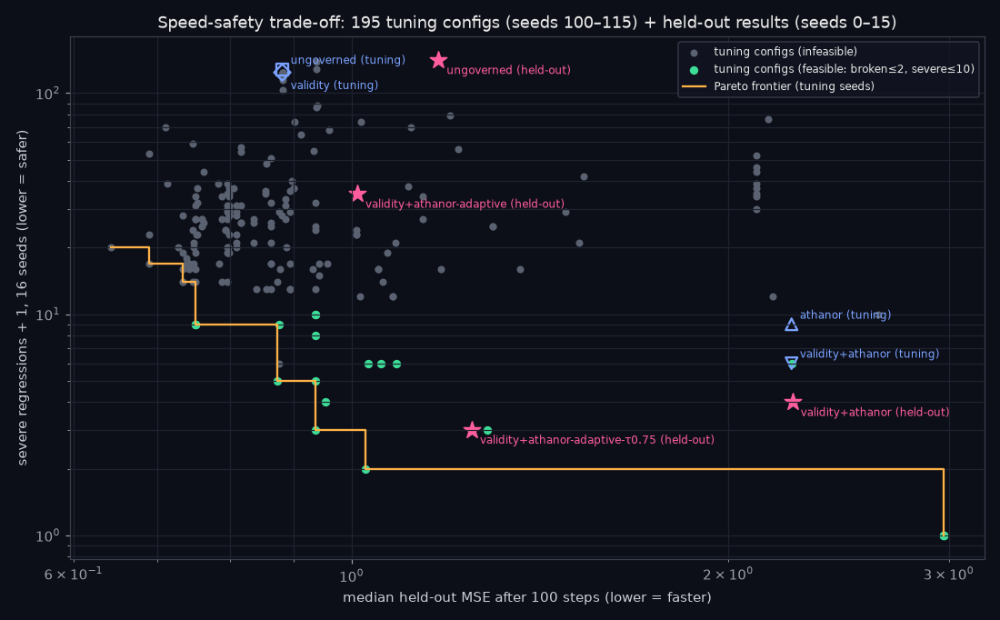

# Tuning log: validity + Athanor with an adaptive drift tolerance (v2.5.0)

**Goal (from the brief):** make the *validity + Athanor* arm of the self-modification experiment ([`docs/selfmod.md`](selfmod.md)) match ungoverned speed while keeping breakages and severe regressions near zero. Keep tuning until improvements plateau.

**Protocol (fixed before tuning started):**
- **Tuning seeds:** 100–115 (16 runs per setting, 1000 steps). **Held-out seeds:** 0–15, used once, after tuning stopped.
- **Feasible:** at most 2 commits that broke the program and at most 10 severe regressions (>2× worse held-out MSE, or broken), summed over the 16 tuning seeds.
- **Objective:** among feasible settings, minimise the median held-out MSE at step 100 (speed). Tie-break on median MSE at step 1000.
- **Plateau / stop rule:** stop when a round improves the best feasible objective by less than 2 %.
- Every evaluated setting is in [`tuning/log.json`](tuning/log.json) (199 entries, including 4 baselines), and in table form in [`tuning/all_experiments.md`](tuning/all_experiments.md). The analysis below comes from [`tuning/analysis.json`](tuning/analysis.json), produced by `experiments/self_modify/analyze_tuning.py`.

Reproduce any round with `experiments/self_modify/tune.py` (each round's exact command is listed below), then run `python experiments/self_modify/analyze_tuning.py`.

## The schedule being tuned

The behaviour term of ΔΦ is divided by a tolerance `tol ≥ floor`. Default `tol = 1` reproduces 2.4.0 exactly:

```
e      = rmse_train / σ_y            (basis "current": current train RMSE; "best": best-so-far → tol can only tighten)
tol₀   = clip(γ · e^p, floor, cap)
tol(t) = floor + (tol₀ − floor) · 2^(−t / t½)      (only if a half-life t½ is set)
d_t    = [ |f_new(x_t) − f_old(x_t)| / (σ_y · tol) ,  w_s · structural_distance ]
```

It uses only the agent's own training error, never held-out data.

## Baselines on the tuning seeds (round 0)

| Arm | broken | severe | MSE@100 | MSE@1000 | steps to < 1.5 |
|---|---:|---:|---:|---:|---:|
| ungoverned | 13 | 127 | 0.881 | 0.756 | 8 |
| validity | 5 | 123 | 0.881 | 0.756 | 8 |
| athanor | 5 | 8 | 2.247 | 1.057 | 489 |
| validity + athanor | 2 | 5 | 2.247 | 1.057 | 489 |

## Rounds

| Round | What changed (hypothesis) | Settings | Feasible | Best feasible MSE@100 | Finding |
|---:|---|---:|---:|---:|---|
| 1 | Coarse grid: τ ∈ {0.5, 0.6, 0.7, 0.8} × γ ∈ {off, 1, 2, 4, 8, 16}, p = 1 | 24 | 5 | 2.247 (τ 0.7, no adaptive) | Loosening τ or raising γ buys speed only by giving up safety (τ 0.5: severe 54–123). τ 0.8 freezes the agent (no edits approved, MSE stays 2.971). |
| 2 | Steeper annealing p ∈ {2, 3} | 12 | 0 | — | Best near-miss τ 0.7, p 3, γ 2: severe 16, MSE@100 0.957. |
| 3 | τ 0.75; dense validity grid (256 inputs) | 12 | 0 | — | The validity grid barely changed anything. Severe plateaued at 11–36. |
| 4 | Basis = best-so-far (monotone tightening), cap ∈ {2, 4, ∞}, floor ∈ {1, 0.7} | 24 | 0 | — | Diagnosis below: severe events came from a **feedback loop**. A worse current error loosened the gate, which allowed worse edits. The best-so-far basis plus a cap removes that loop. Best near-miss: severe 13, MSE@100 0.733. |
| 5 | Refine cap/floor/γ around round 4 | 27 | 0 | — | Severe stuck at 13–36. The remaining events happen mid-run, at tol ≈ 2.3, on seeds stuck at mediocre error. |
| 6 | **Time-decayed slack** t½ ∈ {25, 50, 100, 200} | 32 | 8 | **0.750** | First feasible fast settings. Selected: τ 0.7, p 3, best, cap 6, floor 0.7, t½ 50, γ 6 (severe 8, broken 0, MSE@100 0.750 vs ungoverned 0.881). |
| 7 | Refine cap/floor/t½/γ around round 6 | 54 | 6 | 0.750 (same setting) | **0 % improvement, so the plateau rule triggered.** |
| 8 | One-at-a-time sensitivity around the selected setting | 10 | 2 | 0.750 | The neighbourhood is fragile: see the sensitivity table. |

Commands: round 1 `--round 1 --gammas none,1,2,4,8,16 --grid "threshold_h7=0.5,0.6,0.7,0.8"` (run with the earlier CLI form `--taus`). Round 4 `--gammas 2,4 --grid "threshold_h7=0.7;adaptive_power=2,3;adaptive_basis=best;adaptive_cap=2,4,none;adaptive_floor=1.0,0.7"`. Round 6 `--gammas 4,6 --grid "threshold_h7=0.7;adaptive_power=3;adaptive_basis=best;adaptive_cap=4,6;adaptive_floor=1.0,0.7;adaptive_halflife=25,50,100,200"`. Round 7 `--gammas 6,8 --grid "threshold_h7=0.7;adaptive_power=3;adaptive_basis=best;adaptive_cap=5,6,8;adaptive_floor=0.6,0.7,0.8;adaptive_halflife=35,50,70"`. The exact cfg of every setting is in `log.json`.

**Plateau trace** (best feasible MSE@100 so far): rounds 1–5: 2.247 → round 6: 0.750 → round 7: 0.750 → round 8: 0.750. Tuning stopped after round 7 (round 8 was a sensitivity study only).

### Diagnosis that drove rounds 4–6 (measured)

With the round-2 near-miss (τ 0.7, p 3, γ 2, basis = current), 16 severe events occurred on the tuning seeds. They included `2.97 → 22.5` at tol 11.0 and `113 → 2683` at tol 278: the tolerance had grown *because* the agent had just regressed. With basis = best and cap 4 (round 4), the remaining severe events sat at tol ≈ 2.3 between steps 74 and 304, on seeds whose best error stayed mediocre. Round 6's half-life addressed exactly that.

### Sensitivity around the selected setting (round 8, tuning seeds)

| Change from selected (τ 0.7, p 3, best, cap 6, floor 0.7, t½ 50, γ 6, w_s 0.5) | broken | severe | MSE@100 | MSE@1000 |
|---|---:|---:|---:|---:|
| none (selected) | 0 | 8 | 0.750 | 0.676 |
| τ 0.65 | 1 | 30 | 0.816 | 0.667 |
| τ 0.75 | 0 | **1** | 1.027 | 0.802 |
| p 2 | 0 | 15 | 0.750 | 0.610 |
| p 4 | 8 | 13 | 0.787 | 0.535 |
| basis current | 0 | 30 | 0.750 | 0.457 |
| w_s 0.25 | 0 | 13 | 0.747 | 0.505 |
| w_s 1.0 | 9 | 9 | 2.635 | 0.966 |
| validity grid 256 | 0 | 8 | 0.750 | 0.676 |
| γ 5 | 1 | 12 | 0.855 | 0.736 |
| γ 7 | 0 | 13 | 0.750 | 0.510 |

Almost every single-parameter change breaks feasibility. **The selected optimum is a narrow spike in a rugged landscape**, which is a warning sign for generalisation. For that reason, *before* looking at held-out seeds, I also fixed a second, more conservative setting to report: the τ 0.75 neighbour (severe 1 on tuning seeds).

## Mathematics that emerged (all fitted to logged measurements)

- **Pareto frontier.** Of the 195 tuned settings, the non-dominated set in (MSE@100 ↓, severe ↓) has 8 unique points. A log-log fit on them gives
  `severe + 1 ≈ e^1.64 · MSE@100^(−1.91)`, i.e. **severe + 1 ≈ 5.2 · MSE@100^−1.9**.
  On the frontier, roughly halving the step-100 error costs about 3.7× more severe regressions. This is an empirical fit to 8 points on one toy task, not a law.
- **Off the frontier, speed and safety are unrelated.** Across all adaptive settings, the Spearman rank correlation between MSE@100 and severe count is **0.008**. Most settings are simply dominated. Getting onto the frontier needs the specific structure found in rounds 4–6 (monotone basis, cap, decay).
- **τ alone (no adaptive, round 1)** is a step function, not a smooth dial:

  | τ | MSE@100 | severe | median steps to < 1.5 |
  |---:|---:|---:|---:|
  | 0.5 | 0.934 | 54 | 11.5 |
  | 0.6 | 2.152 | 75 | 294.5 |
  | 0.7 | 2.247 | 5 | 489 |
  | 0.8 | 2.971 | 0 | never |

  At τ = 0.8 the threshold sits right at the structural cost of the smallest structural edit (`x → x + c` costs `w_s · 0.5 = 0.25`, and C ≥ 0.8 needs ΔΦ ≤ 0.25), so nothing structural passes. τ, w_s and the probe set interact through `ΔΦ_max = 1/τ − 1`.
- **Feedback instability.** With `basis = current`, the tolerance is a positive feedback on regressions (worse error → looser gate → worse edits). Measured: severe 30 vs 8 for the otherwise-selected setting.



## Held-out evaluation (seeds 0–15, run once, after tuning stopped)

| | tuning seeds | held-out seeds |
|---|---|---|
| ungoverned: severe / MSE@100 | 127 / 0.881 | 140 / 1.173 |
| **selected** (τ 0.7, adaptive): broken / severe / MSE@100 / MSE@1000 | 0 / 8 / 0.750 / 0.676 | 0 / **34** / 1.011 / 0.697 |
| **conservative** (τ 0.75, adaptive): broken / severe / MSE@100 / MSE@1000 | 0 / 1 / 1.027 / 0.802 | 0 / **2** / 1.247 / 0.903 |

- **The selected setting overfit its safety.** Severe regressions went from 8 to 34 on held-out seeds. Its speed held up: MSE@100 was 0.86× ungoverned on both seed sets, and MSE@1000 was 0.697 vs 0.862 ungoverned.
- **The conservative setting generalised.** It had 0 broken, 2 severe (vs 3 for non-adaptive validity + Athanor and 140 for ungoverned), and its worst committed MSE was 3.8. Its MSE@100 is within 6 % of ungoverned (1.247 vs 1.173) and MSE@1000 within 5 % (0.903 vs 0.862). **It does not match ungoverned speed on every measure:** median steps to < 1.5 is 34.5 vs 8.5, and median best-ever MSE is 0.819 vs 0.206.

**Where it plateaued:** on the tuning seeds, at MSE@100 = 0.750 with 8 severe regressions (vs ungoverned 0.881 / 127). On held-out seeds, the best safe setting gets near-ungoverned error at steps 100 and 1000 with near-zero breakage and severe regressions. It still reaches good solutions about 4× more slowly by time-to-1.5, and its best-ever error is about 4× worse. Held-out results were not used for any further tuning.

## 2.6.0: transfer to the TSP self-modifier

Protocol: first carry the 2.5 settings over unchanged, then run one small tuning pass, then evaluate once on
held-out seeds.
- **Tuning data:** seeds 100–115 on a *separate* 32-instance tuning set (`tuning_sets()`). Held-out seeds 0–15
  and the held-out instances were never used here.
- **Unchanged 2.5 rule:** feasible = ≤ 2 broken and ≤ 10 severe over the 16 tuning seeds. Minimise median
  ratio@50, then tie-break on ratio@1000.
- **Base config:** every config is validity + adaptive (γ 6, p 3, basis best, floor 0.7) with the listed
  overrides. `t½ = 0` means no time decay.
- **Log:** [`tsp_selfmod/tuning_log.json`](tsp_selfmod/tuning_log.json) has all 36 settings.

| round | grid | best feasible (τ, t½, cap): broken / severe / @50 / @1000 / never good | note |
|---|---|---|---|
| 1 | τ {0.70, 0.75} × t½ {50, 200, none} × cap {6, 12} | none feasible | every config ≥ 4 broken. The carried-over conservative (0.75, 50, 6) scored 4 / 4 / 1.061 / 1.089 / 7 |
| 2 | τ {0.80 … 0.95} × t½ {200, none} | (0.80, none, 6): 1 / 4 / 1.085 / 1.042 / 6 | τ ≥ 0.85: all 16 seeds frozen |
| 3 | τ {0.77, 0.78, 0.79, 0.81, 0.82} × t½ {400, none} | **(0.78, none, 6): 2 / 4 / 1.037 / 1.031 / 2** | 4.4% better @50 than round 2. τ 0.77 is infeasible (3 broken) |
| 4 | τ {0.775, 0.78, 0.785} × cap {3, 12}, no decay | no improvement (cap 12 ties; cap 3 freezes all 16) | **plateau** (< 2%). Kept cap 6 (fewest changes from 2.5) |

Selected: τ 0.78, no time decay; everything else as v2.5 (`experiments/tsp_selfmod/tuned.json`). Tuning seeds
→ held-out seeds, broken/severe: 2/4 → 2/2. Held-out ratio@1000 was 1.046, the same as validity only (1.046),
with severe regressions 2 vs 21.

### Mathematics that emerged: the admission condition and the lockout window

With `C = 1/(1+ΔΦ)`, a probe passes iff `ΔΦ ≤ 1/τ − 1`. An edit is APPROVEd iff `H7 ≥ τ`, i.e. iff at least
`⌈τP⌉` of the `P` probes pass. With ΔΦ per probe = `r_i/(κ·tol)` (`r_i` = relative length change; the structural
term is ≈ 0.005 here and is ignored), this gives

  **APPROVE ⇔ tol ≥ r₍⌈τP⌉₎ · τ / (κ (1 − τ))**, where r₍k₎ is the k-th smallest probe change.

Measured for the smallest "turn on 2-opt" edit (`budget(n) = 1`, P = 16, κ = 0.10), the required tol is:

| τ | 0.70 | 0.75 | 0.78 | 0.80 | 0.82 | 0.85 |
|---|---:|---:|---:|---:|---:|---:|
| required tol | 2.34 | 3.01 | 3.83 | 4.32 | 5.40 | 6.71 |

It explains every freeze in the log:
- **Fixed tol 1** fails for every τ, so non-adaptive Athanor froze on 16 of 16 seeds.
- **cap 3** is below the 3.83 needed at τ 0.78 (and about the same at 0.775 and 0.785), so round 4 froze on all 16 seeds.
- **cap 6** < 6.71 at τ 0.85, so round 2 froze on all 16 seeds, while τ 0.82 (5.40 < 6) did not freeze.

**Lockout window.** With the 2.5 decay `tol(t) = f + (cap − f)·2^(−t/t½)` (while e is large, so the cap
binds), the edit can pass only for `t ≤ t½ · log₂((cap − f)/(tol_req − f))`. For the carried-over conservative
setting (f 0.7, cap 6, t½ 50, τ 0.75) that is **≈ 60 steps**. If the unlocking edit is not proposed by then, it
can never be admitted. That matches 9 of 16 held-out runs never reaching good. The half-life is measured in
steps, so it encodes the 2.5 task's improvement timescale. That is the part of the schedule that did not
transfer. The error-driven part (`γ·e^p`, best-so-far basis, cap) did.
