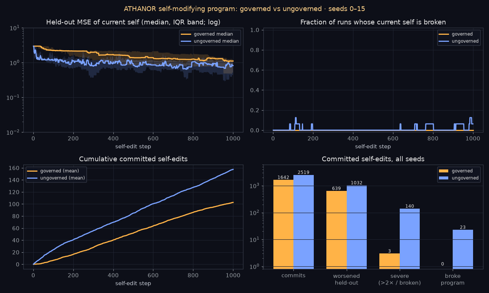

# Does ATHANOR help a real self-modifying program?

*v2.4.0 · 16 seeds × 1000 self-edit steps · fully offline and deterministic*

**Short answer:** in this experiment the governed agent avoided almost every catastrophic self-edit. It committed **0** program-breaking edits versus **23**, and **3** severe regressions versus **140**. But it improved **much more slowly**, and after 1000 steps its typical held-out error is **worse** (median 1.110 vs 0.862). There is also an important nuance: the gate itself would have **APPROVED 20 of the 23** breaking edits the ungoverned agent made. The governed agent stays clear of breakage mostly because it takes a different, more conservative path through program space, not because H7 detects breakage. It is a stability-for-speed trade, not a free win.



## The system

`src/athanor/selfmod/agent.py` is a program whose "self" is the source of one function:

```python
def f(x):
    return x
```

Each step the agent:
1. reads its current source and parses it with `ast`,
2. applies one random mutation: tweak a constant, swap `+ - * /`, wrap a subtree in `math.sin/cos/tanh/exp/log/sqrt`, replace a leaf, grow, or prune,
3. `ast.unparse`s the result to new source, then compiles and executes it (inside a whitelisted grammar: only `x`, constants, `+ - * /` and those six `math` functions),
4. keeps the edit if it lowers squared error on a random **minibatch of 8** noisy training points.

That greedy, noisy self-improvement rule is what makes the problem real. An edit can look better on 8 points and be worse everywhere else, and edits can genuinely **break** the program: `math.log`/`math.sqrt` of a negative, division by zero, overflow. The breakage might only show up on inputs the minibatch didn't contain.

**Task:** fit `y = sin(x) + 0.3·x²` on `x ∈ [-3, 3]` from 40 noisy training points (σ = 0.1). **Performance** is MSE on a separate noise-free held-out grid of 200 points that the agent never trains on. For scale: the starting program `f(x) = x` scores 2.971, and predicting the held-out mean would score 1.182 (the target's variance).

## How ΔΦ is measured

For a proposed edit `old → new`, evaluated at 32 fixed probe inputs `x_t` (offset from the held-out grid):

```
d_t = [ |f_new(x_t) − f_old(x_t)| / σ_y ,  0.5 · structural_distance(old_src, new_src) ]
```

- The **behaviour** term is real output divergence, normalised by the target's standard deviation. A probe where either version raises or returns a non-finite value gets 1000.
- The **structure** term is the normalised multiset distance between the two programs' AST token bags (constants, operators, function calls, `x`).

The `d_t` are laid out as a trajectory (cumulative sum). ATHANOR's own unchanged pipeline then produces `ΔΦ_t = ‖d_t‖ → C_t = 1/(1+ΔΦ_t) → H7 = mean(C_t ≥ 0.70)`, and `VerifierAgent` returns APPROVE (H7 ≥ 0.70), REFINE (0.50–0.70) or REJECT. In words, **H7 is the fraction of probe inputs on which the self-edit stays coherent with the current self.**

- **Governed:** an improving edit is committed only on APPROVE. On REFINE the agent retries up to 2 times with a gentler edit (a constant tweak at scale 0.5ᵏ). A REJECT is discarded.
- **Ungoverned:** the same verdicts are computed and written to the ledger, but every improving edit is committed.

Everything else (task data, minibatches, mutation random streams) is identical between modes for a given seed.

## Results

Reproduce with:

```bash
athanor selfmod --seeds 0-15 --steps 1000 --out docs/selfmod --chart docs/assets/selfmod.png
# or: python experiments/self_modify/run.py   (add --ledgers to keep a hash-chained ledger + final_self.py per run)
```

| Metric (16 seeds × 1000 steps) | Governed | Ungoverned |
|---|---:|---:|
| Median held-out MSE after 25 steps | 2.971 | **1.382** |
| … after 100 steps | 2.250 | **1.173** |
| … after 200 steps | 2.146 | **1.137** |
| … after 1000 steps | 1.110 | **0.862** |
| Median best-ever held-out MSE per run | 0.899 | **0.206** |
| Median steps to reach held-out MSE < 1.5 ¹ | ~300 (3 seeds never) | **~9** |
| Runs broken at the end | **0** | 1 |
| Committed self-edits | 1642 | 2519 |
| Commits that worsened held-out MSE | **639** | 1032 |
| Severe regressions (>2× worse, or broken) | **3** | 140 |
| Commits that broke the program on held-out inputs | **0** | 23 |
| Steps spent running a broken self | **0** | 167 |
| Worst held-out MSE ever committed (finite) | **528** | 2.2 × 10¹⁴³ |
| Commits whose verdict was REFINE/REJECT | 0 | 723 |
| Median ΔΦ / C of committed edits | 0.089 / 0.921 | 0.180 / 0.862 |
| Verdicts APPROVE / REFINE / REJECT | 6112 / 566 / 7370 | 6618 / 1458 / 5100 |
| Verdict the gate gave the commits that **broke** the program (A / RF / RJ) | n/a | 20 / 2 / 1 |
| Verdict the gate gave the **severe-regression** commits (A / RF / RJ) | 3 / 0 / 0 | 56 / 25 / 59 |

¹ Computed from the per-step series (`--full-json`). Best-ever MSE is `best_test_mse` per run in `results.json`.

Per seed, final held-out MSE is lower for the governed run on **7/16** seeds and for the ungoverned run on **9/16**. The full per-seed table is in [`selfmod/results.md`](selfmod/results.md), and machine-readable results are in [`selfmod/results.json`](selfmod/results.json).

## What this shows

**Where the governor helps**
- **Catastrophic regressions:** 140 vs 3 commits that more than doubled held-out error (or broke the program). In the ungoverned runs, single commits pushed held-out MSE as high as 10¹⁴³. The governed worst case was 528. Looking at the verdicts on those 140 ungoverned commits, the gate would have blocked **84** of them directly (25 REFINE + 59 REJECT).
- **Breakage, indirectly:** 23 ungoverned commits produced a program that raised or went non-finite on held-out inputs (seed 9 ends broken), and the governed agent committed none. But the gate would have **approved 20 of those 23 edits**. They fail only at a few isolated inputs, such as a pole or a `log`/`sqrt` boundary, which affects too few of the 32 probes to pull H7 below 0.70. The governed agent avoids breakage mainly because its slower, lower-drift trajectory keeps it in simpler programs where such edits are rarer. That is an indirect effect, and it shouldn't be read as "H7 catches crashes".
- **Auditability:** with `--ledgers`, every proposed self-edit, its verdict, its REFINE trail and the SHA-256 of the resulting source go into a hash-chained ledger that `athanor verify` can check.

**Where the governor hurts**
- **Slower improvement.** The program starts far from the target, and the big early edits that help most are exactly the large-ΔΦ edits the governor rejects. The ungoverned agent reaches MSE < 1.5 in about 9 steps (median). The governed agent needs about 300, and 3 seeds never get there.
- **Worse typical outcome at 1000 steps.** Median final MSE is 1.110 vs 0.862, and median best-ever is 0.899 vs 0.206. On 9/16 seeds the ungoverned run ends better.
- **It doesn't stop ordinary regressions.** 639 governed commits still worsened held-out error. Small, coherent edits that overfit the minibatch pass the gate by design, because ΔΦ measures *change*, not *correctness*.

## Caveats (read before citing)

- This is one small toy system: symbolic regression with ≤ 40-node expressions and a deliberately naive, noisy acceptance rule. It is not an LLM or a general agent. Treat the numbers as evidence about this setup only.
- ΔΦ is probe-based, and H7 is a *fraction* of probes. An edit that breaks on a few inputs (or between probes) can still be APPROVED, and on the ungoverned trajectory 20 of 23 breaking edits were. If you need crash-freedom, add an explicit hard check. H7 is a drift limit, not a correctness test.
- The ungoverned baseline has no safety checks of its own. A simple "reject any edit that crashes on a probe set" rule would also remove most breakages. ATHANOR's added value over such a rule here is mainly the graded drift limit (fewer severe regressions) and the audit trail. That rule wasn't benchmarked separately.
- The settings (τ = 0.70, refine floor 0.50, structure weight 0.5, 32 probes, minibatch 8, 1000 steps, seeds 0–15) were fixed before the final run and **not tuned** to favour either mode. Different settings will move the trade-off. A lower τ, for example, should speed up the governed agent and admit more risky edits.
- Results are deterministic for a given software stack. Float details may differ across Python/NumPy builds.
