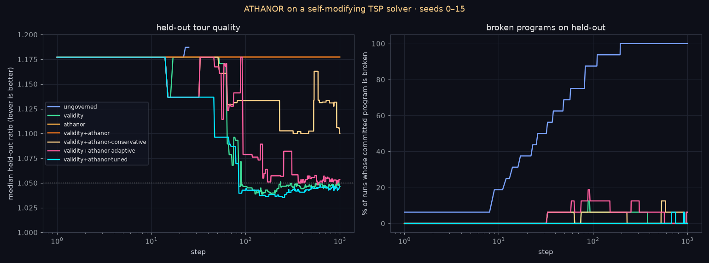

# Transfer test: a self-modifying TSP solver (v2.6.0)

2.4–2.5 tested ATHANOR on one small self-modifier (a single symbolic-regression expression). 2.6.0 asks whether
the **v2.5 conservative setting transfers, without retuning,** to a second, larger and more realistic
self-modifying system. Everything is offline and deterministic, and no paid API is used.

## The system (`src/athanor/selfmod/tsp_program.py`, `tsp_experiment.py`)

**The agent's self** is a whole Python module with six cooperating functions: `priority` (greedy scoring
heuristic), `pick_start`, `construct` (nearest-neighbour tour builder with a `while` loop), `budget` (number of
2-opt passes), `improve` (2-opt with slice reversal) and `solve`. The seed program ships with `budget(n) = 0`,
so 2-opt is disabled and the seed is a weak greedy solver (held-out ratio 1.177). The only big win is to find an
edit that turns 2-opt on (ratio ≈ 1.034), and then to avoid wrecking it.

**Proposer: programmatic AST mutation, not an LLM.** A local LLM was checked and is not feasible on this box:
there is no model cache or llama.cpp, only about 3 GB of free RAM, and no GPU. So each step makes one random AST
edit anywhere in the module: tweak a constant, swap an arithmetic or comparison operator, swap a local name, grow
or wrap a heuristic expression (`+ - * /`, `sqrt/log/exp/tanh`), prune, or shift an index or slice bound by ±1.
REFINE retries are gentle constant tweaks (scale 0.5ᵏ). A whitelist sandbox rejects imports, dunders and unknown
calls.

**Real failure modes** (all are measured outcomes, not simulated):

| failure | how it arises |
|---|---|
| crash | `IndexError`, `TypeError`, `ZeroDivisionError`, math domain errors from mutated code |
| runaway loop | the harness instruments every loop with a tick counter the agent cannot edit, giving a deterministic `TimeoutError` past 60 000 iterations (e.g. a flipped 2-opt comparison plus a large budget) |
| silent wrong answer | e.g. `while len(tour) < n - 2` returns a tour that drops cities. The agent's own scoring measures the closed path it returns, so such a tour *looks shorter* (reward hacking); only a permutation check exposes it |
| held-out regression | valid but longer tours, or failures that only appear on the larger held-out instances |

**Tasks.** Euclidean instances, half uniform and half clustered:
- 16 fixed **probe** instances (n 8–16), used for ΔΦ;
- per seed, 24 **training** instances (n 10–30) with a minibatch of 4;
- 32 fixed **held-out** instances (n 20–45), never seen by the agent;
- a separate 32-instance **tuning** set (same distribution, different instances), used only by the tuning pass.

Score = mean tour length / harness reference, where the reference is the best of nearest-neighbour from every
start plus 2-opt to convergence. Lower is better.

**The agent wants** to commit any edit that lowers its own (lenient) minibatch score. The arms decide what else
must hold:

- **validity**: `validity_check` is reused unchanged over a unit-test-style suite. The suite solves the probes,
  the agent's training instances, an n = 3 case and a duplicate-points case, and requires each tour to be a
  permutation. It also unit-tests `priority`, `budget` (finite, ≥ 0) and `pick_start`. It uses no held-out data.
- **athanor**: `VerifierAgent` is reused unchanged on ΔΦ.

**ΔΦ from real change.** Per probe, `|L_new − L_old| / (L_old · κ · tol)` with κ = 0.10 fixed a priori (a 10%
tour-length change plays σ_y's role). It is BIG = 1000 if either program fails. To that is added
`w_s` × module-level AST token-bag distance. The trajectory is `[0; cumsum(d_t)]`, as in 2.4. The adaptive
schedule `scheduled_tolerance` is the 2.5 code, factored out with no behaviour change: the 2.5 exact-reproduction
test still passes. It uses `e = (train_ratio − 1)/κ`.

**Metrics (pre-defined).**
- **severe**: a commit that breaks the held-out program, or that worsens the held-out ratio by more than 0.05.
- **good**: held-out ratio ≤ 1.05.
- **checkpoints**: step 50 (early) and step 1000 (late).
- **broken**: the held-out program fails on any instance. A broken program counts as worst in medians.

## Results: held-out seeds 0–15, 1000 steps (`docs/tsp_selfmod/results.md`)



| arm | broken commits (crash/timeout/silent) | broken at end | severe | worst committed ratio | held@50 | held@1000 | best | steps to ≤ 1.05 (never) | % run-steps broken |
|---|---|---:|---:|---:|---:|---:|---:|---|---:|
| ungoverned | 16 (0/1/15) | 16 | 17 | 1.201 | broken | broken | 1.177 | never (10) | 95.3 |
| validity | 4 (0/4/0) | 1 | 21 | 2.376 | 1.177 | 1.046 | 1.032 | 75.5 (0) | 2.3 |
| athanor | 0 | 0 | 0 | 1.177 | 1.177 | 1.177 | 1.177 | never (16), frozen | 0.0 |
| validity + athanor | 0 | 0 | 0 | 1.177 | 1.177 | 1.177 | 1.177 | never (16), frozen | 0.0 |
| **v2.5 conservative, carried over** (τ 0.75, t½ 50) | 4 (1/3/0) | 0 | 5 | 1.201 | 1.177 | 1.100 | 1.098 | never (9) | 4.0 |
| v2.5 tuned, carried over (τ 0.70, t½ 50) | 6 (0/6/0) | 1 | 7 | 1.201 | 1.167 | 1.053 | 1.032 | 57.0 (6) | 4.4 |
| **retuned on seeds 100–115** (τ 0.78, no decay) | 2 (0/2/0) | 0 | 2 | 1.201 | 1.096 | 1.046 | 1.033 | 76.0 (3) | 0.5 |

Medians over 16 seeds. The "worst committed ratio" is the worst *non-broken* held-out ratio ever committed;
breakage is counted separately.

**Counterfactual on the ungoverned breaks** (`experiments/tsp_selfmod/shadow_gate.py`,
`docs/tsp_selfmod/shadow_gate.json`). Replaying each ungoverned run to its first breaking commit, the fixed gate
and the carried-over conservative gate would both have **REJECTED 15 of 16**. Those 15 are all the silent
wrong-answer edits (H7 = 0, because dropping cities changes every probe's length). Both gates would have
**APPROVED the 1** timeout, which behaves identically on the small probes. This is the opposite of 2.4, where the
gate would have approved 20 of 23 breaking edits. ΔΦ catches failures that change behaviour *on the probes*, and
nothing else.

## Does the v2.5 conservative setting transfer without retuning?

**Partly. Its safety transferred in kind but not in degree, and its speed did not transfer.**

- **Safety, compared with the right baselines.** The v2.5 conservative setting cut severe regressions from 21
  (validity only) to 5, and committed breakages from 16 (ungoverned) to 4. It never ended a run broken. But it
  committed **as many breaking edits as validity alone (4)**, and it misses the 2.5 feasibility rule (≤ 2
  broken), which held in 2.5. Every one of its 4 breaks got an **APPROVE**: 3 timeouts and 1 crash that occur
  only on the larger held-out instances (n up to 45) and never on the probes (n ≤ 16) or the check suite
  (n ≤ 30). Neither the gate nor validity can see a failure outside the inputs they run.
- **Speed did not transfer.** 9 of 16 runs never reached ≤ 1.05, and the median final ratio is 1.100 against
  1.046 for validity only. The cause is the step-based half-life (t½ = 50), derived in [TUNING_LOG.md](TUNING_LOG.md#260-transfer-to-the-tsp-self-modifier): it
  closes the window in which the one large beneficial edit can pass.
- **Fixed-tolerance Athanor froze on every seed** (0 commits). The edit that turns on 2-opt changes probe
  lengths by up to about 30%, far beyond what τ 0.7 at tol 1 admits.

**After a small tuning pass** (36 settings, 4 rounds, tuning seeds 100–115 on the separate tuning instances,
the 2.5 feasibility/objective rule unchanged, plateau in round 4), the selected setting was τ 0.78 with **no
time decay**. It was evaluated once on held-out seeds. Among the arms that did not freeze, it was best or tied-best on
every safety row:
- 2 broken commits (both timeouts on large instances, both APPROVEd), 2 severe, 0 runs broken at end, and 0.5%
  of run-steps broken;
- final quality equal to validity only (1.046), and better at step 50 (1.096 vs 1.177);
- tuning seeds → held-out went 2/4 → 2/2 (broken/severe), so unlike 2.5 the safety did not overfit.

It is still not free: 3 of 16 runs never reach ≤ 1.05 (validity alone: 0), and τ 0.77 was infeasible on the
tuning seeds, so the optimum again sits next to a cliff.

## Caveats

- This is still a toy: one domain, an AST-mutation proposer (not an LLM), 16 seeds, and a single large
  "unlock" edit that dominates the dynamics. The ±1 index/slice mutations make silent wrong answers common;
  a different mutation mix would change the numbers.
- κ = 0.10, the probe sizes and the tick limit were chosen a priori, but they were still choices, and the
  timeout failures are a direct consequence of probes being smaller than held-out instances. Larger probes
  would likely catch them, but would change ΔΦ and were not tried, to keep the carried-over comparison clean.
- GOOD_RATIO = 1.05 was fixed after seeing the seed program (1.177) and plain 2-opt (1.034), and after one
  60-step smoke run on seed 0, but before any arm results.
- The counterfactual tolerance uses the pre-edit training error as the schedule basis (an approximation of the
  best-so-far basis).

Reproduce (about 100 s on 8 cores):

```bash
python experiments/tsp_selfmod/run.py --with-tuned            # held-out table + chart
python experiments/tsp_selfmod/tune.py --round 1 --grid "threshold_h7=0.70,0.75;adaptive_halflife=50,200,0;adaptive_cap=6,12"
python experiments/tsp_selfmod/shadow_gate.py
```
